<!-- FOLD:START -->
<a href="https://www.rcsb.org/structure/4IPF"></a>
<p align="center"><sub>fold of the day · <a href="https://www.rcsb.org/structure/4IPF"><b>4IPF</b> · E3 ubiquitin-protein ligase Mdm2</a> · <i>Xenopus laevis</i> · X-ray 1.7 Å</sub></p>
<!-- FOLD:END -->

### `$ whoami`

```text
>sudhishgupta | BTech Biotechnology & Bioinformatics, Minor in AI @ IIT Hyderabad
MD simulations · DNA Biophysics · Protein Language Models · Generative Biology
```

### Selected work

| Project | What it does |
|---|---|
| [**SDNA**](https://github.com/sudhishgupta/SDNA) | Web-based interface for drawing custom DNA constructs |
| [**FUN-FoldUNet**](https://github.com/sudhishgupta/FUN-FoldUNet) | Deep-learning framework for unconditional generation of protein and peptide backbones |
| [**PrionForge.ai**](https://github.com/sudhishgupta/PrionForge.ai) | PLM-powered generation of novel prion-like proteins with precise subcellular targeting |
| [**CG-DNA-PARAM**](https://github.com/sudhishgupta/CG-DNA-PARAM) | Helix parameters from coarse-grained DNA trajectories |
| [**DeepArt**](https://github.com/sudhishgupta/DeepArt) | Neural artistic style transfer |


